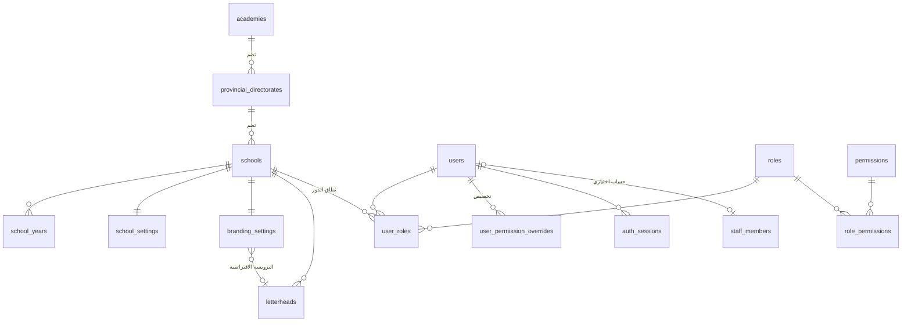
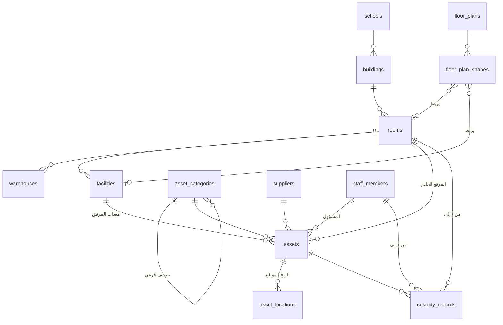
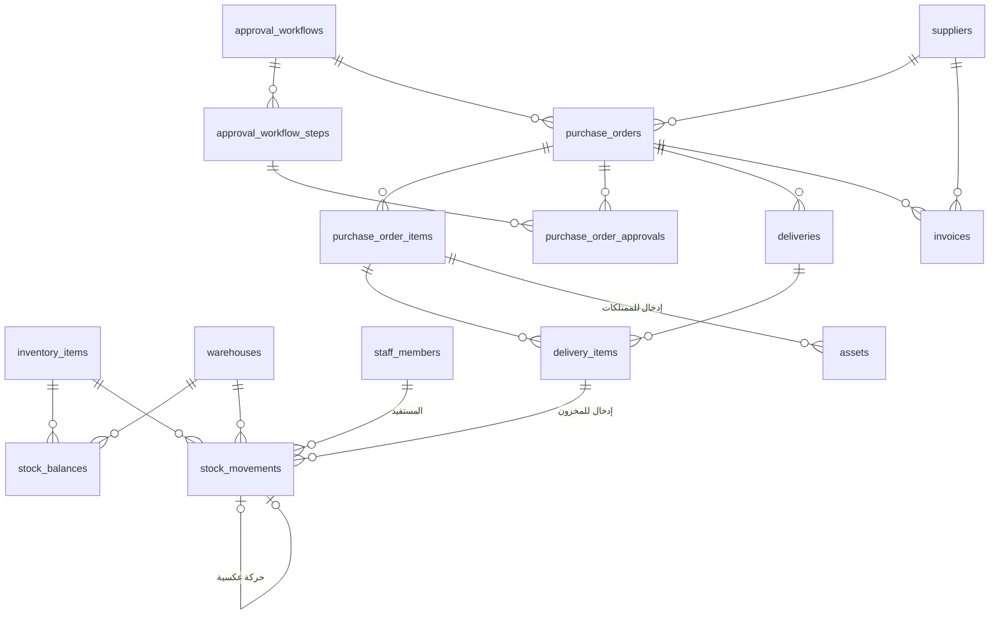
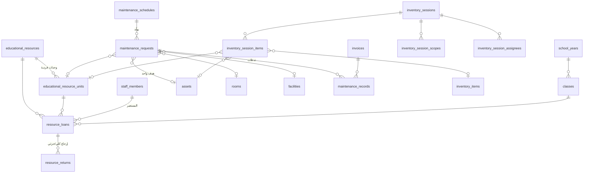
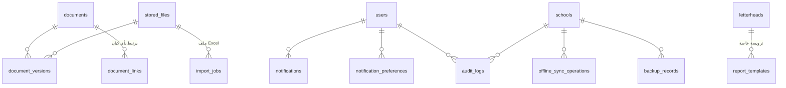

# تصميم قاعدة البيانات — DATABASE_DESIGN

> الحالة: **مُصمَّم ومُتحقَّق منه في المرحلة الأولى** — لم يُربط بالخادم بعد (المرحلة الثالثة).
> المصدر المرجعي: [`database/prisma/schema.prisma`](database/prisma/schema.prisma) + [`database/prisma/sql/constraints.sql`](database/prisma/sql/constraints.sql).

## 1. ما تم التحقق منه فعلياً

| التحقق | النتيجة |
|---|---|
| `prisma validate` (Prisma 7.10.1) | ✅ المخطط صالح |
| توليد SQL من المخطط وتطبيقه على PostgreSQL 16 فارغة | ✅ 63 جدولاً |
| تطبيق `constraints.sql` (CHECK، فهارس جزئية، مشغّلات) | ✅ |
| `tests/database/constraints.test.sql` عبر `scripts/test-db-constraints.sh` | ✅ 12/12 |

الاختبارات الـ12: رصيد سالب ممنوع، تعديل/حذف حركة مخزون ممنوع، تعديل/حذف سجل التدقيق ممنوع، إعارة وحدة معارة ممنوعة، إعادة إعارتها بعد الإرجاع مسموحة، تكرار رقم الجرد ممنوع، ممتلك بتصنيف غير موجود ممنوع، مديرية بلا أكاديمية ممنوعة، طلب صيانة بلا هدف ممنوع، تكرار قيمة قائمة عامة ممنوع.

## 2. المبادئ

1. **تعدد المؤسسات وعزلها**: كل جدول تشغيلي يحمل `schoolId`. الخادم يفرض المؤسسة من صلاحيات المستخدم (لا يثق في `schoolId` القادم من العميل). خيار إضافي لاحق: Row-Level Security في PostgreSQL.
2. **المعرفات**: UUID لكل الكيانات، و`BigInt` تسلسلي لسجل التدقيق (حجم كبير وترتيب زمني).
3. **الأرقام الإدارية** (رقم الجرد، رقم الإعارة، رقم الطلب...) فريدة داخل المؤسسة `@@unique([schoolId, number])`، وتُولَّد من `number_sequences` داخل المعاملة.
4. **لا حذف فعلي للسجلات الحساسة**: `archivedAt` أو حالة `CANCELLED`، والتصحيح بحركات عكسية.
5. **الرصيد لا يُدخل يدوياً**: `stock_balances` ذاكرة مؤقتة تُحدَّث فقط داخل نفس المعاملة التي تنشئ الحركة، مع `CHECK (quantity >= 0)` كخط دفاع أخير.
6. **القوائم القابلة للتعديل** في جدول واحد `lookup_values` (بمفتاح `listKey`)، والتعدادات (enums) فقط للحالات التي يبني عليها النظام منطقه (حالة الإعارة، حالة الصيانة...).
7. **لا بيانات واقعية مفترضة**: لا يحتوي المخطط ولا الـseed على أعداد حجرات أو ممتلكات. البيانات الافتراضية الوحيدة المقترحة هي التسلسل الإداري (أكاديمية سوس ماسة ← مديرية أكادير إداوتنان ← المؤسسة) وتبقى قابلة للتعديل.

## 3. الوحدات والجداول

| الوحدة | الجداول |
|---|---|
| التسلسل الإداري | `academies`, `provincial_directorates`, `schools`, `school_years`, `school_settings` |
| الهوية البصرية | `branding_settings`, `letterheads`, `stored_files` |
| المستخدمون والصلاحيات | `users`, `auth_sessions`, `roles`, `permissions`, `role_permissions`, `user_roles`, `user_permission_overrides` |
| القوائم والترقيم | `lookup_values`, `number_sequences` |
| الفضاءات | `buildings`, `rooms`, `facilities`, `warehouses`, `floor_plans`, `floor_plan_shapes` |
| الممتلكات | `asset_categories`, `assets`, `asset_locations` |
| المخزون | `inventory_items`, `stock_balances`, `stock_movements` |
| الاقتناء | `suppliers`, `approval_workflows`, `approval_workflow_steps`, `purchase_orders`, `purchase_order_items`, `purchase_order_approvals`, `deliveries`, `delivery_items`, `invoices` |
| الأشخاص والأقسام | `staff_members`, `classes`, `_ClassTeachers` |
| الوسائل التعليمية والإعارة | `educational_resources`, `educational_resource_units`, `resource_loans`, `resource_returns` |
| الصيانة | `maintenance_requests`, `maintenance_records`, `maintenance_schedules` |
| الجرد | `inventory_sessions`, `inventory_session_scopes`, `inventory_session_assignees`, `inventory_session_items` |
| العهدة | `custody_records` |
| الوثائق | `documents`, `document_versions`, `document_links` |
| الإشعارات | `notifications`, `notification_preferences` |
| التدقيق والمزامنة والنسخ | `audit_logs`, `offline_sync_operations`, `backup_records`, `import_jobs`, `report_templates` |

### فروقات عن قائمة الجداول في المواصفات (تحتاج موافقتك)

| في المواصفات | في التصميم | السبب |
|---|---|---|
| `teachers` | `staff_members` مع حقل `type` (أستاذ، إداري، عون، آخر) | العهدة وصرف المخزون تُسلَّم لموظفين ليسوا أساتذة. الأساتذة = `type = TEACHER`. |
| `asset_locations` | سجل تاريخي لمواقع الممتلك | الموقع الحالي حقل `roomId` في `assets`، والجدول يحفظ التاريخ. |
| — | `stock_balances` | رصيد محسوب من الحركات ومحمي بقيد، لتسريع الاستعلامات والتنبيهات. |
| — | `lookup_values` | تحقيق مبدأ «كل القوائم قابلة للتعديل» دون جدول لكل قائمة. |
| — | `stored_files` | سجل موحد للملفات (شعار، ترويسة، صور، وثائق) مع بصمة SHA-256. |
| — | `approval_workflows` + `steps` + `purchase_order_approvals` | مسار مصادقة مرن حسب مصدر التمويل (المادة 17). |
| — | `invoices`, `document_links`, `import_jobs`, `report_templates`, `floor_plans`, `number_sequences`, `auth_sessions`, `user_permission_overrides`, `inventory_session_scopes/assignees` | تفاصيل لازمة لتنفيذ المتطلبات. |

## 4. مخططات العلاقات (ERD)

المخطط مقسم حسب الوحدات لسهولة القراءة. ملف Mermaid الكامل: [`docs/ERD/erd.mmd`](docs/ERD/erd.mmd).

### 4.1 التسلسل الإداري والمستخدمون

### 4.2 الفضاءات والممتلكات والعهدة

### 4.3 المخزون والاقتناء

### 4.4 الوسائل التعليمية والإعارة والصيانة والجرد

### 4.5 الوثائق والإشعارات والتدقيق

## 5. القواعد الحرجة وكيف تُفرض

| القاعدة | التطبيق (الخادم) | خط الدفاع في القاعدة |
|---|---|---|
| منع صرف أكبر من الرصيد | معاملة `SERIALIZABLE` أو `SELECT ... FOR UPDATE` على `stock_balances` ثم إنشاء الحركة وتحديث الرصيد | `CHECK (quantity >= 0)` |
| كل حركة مسجلة ولا تُحذف | لا يوجد endpoint للحذف؛ التصحيح بـ `REVERSAL` بصلاحية `stock.reverse` | مشغّل يمنع UPDATE/DELETE |
| منع إعارة وسيلة معارة | قفل الوحدة + التحقق من حالتها | فهرس جزئي فريد على `unitId` للإعارات النشطة |
| منع إعارة وسيلة معطوبة | التحقق من `status = AVAILABLE` | — |
| إعارة جزء من الكمية | المتاح = الإجمالي − المعطوب − المعار حالياً (داخل معاملة مقفلة) | `CHECK` على الكميات |
| عدم تكرار رقم الجرد | توليد من `number_sequences` + فحص الاستيراد | `UNIQUE(schoolId, inventoryNumber)` |
| سجل التدقيق لا يُحذف | لا endpoint | مشغّل append-only |
| عدم تكرار العمليات دون اتصال | `clientOpId` من العميل | `UNIQUE(clientOpId)` |
| سلامة التسلسل الإداري | قوائم مترابطة | مفاتيح خارجية `RESTRICT` |

### ملاحظة حول رقم الجرد
رقم الجرد فريد داخل كل جدول (الممتلكات / وحدات الوسائل التعليمية). إذا أردت أن يكون **سجل أرقام جرد واحد مشترك** بين الممتلكات والوسائل التعليمية، يُضاف جدول `inventory_numbers` مركزي. (قرار مطروح عليك.)

## 6. الفهارس الرئيسية
- `assets(schoolId, status)`, `assets(schoolId, categoryId)`, `assets(roomId)`
- `stock_movements(itemId, warehouseId, occurredAt)`, `stock_movements(schoolId, occurredAt)`
- `resource_loans(schoolId, status, dueAt)` — لاستعلام الإعارات المتأخرة
- `maintenance_requests(schoolId, status, urgency)`
- `audit_logs(schoolId, createdAt)`, `audit_logs(entityType, entityId)`
- `notifications(userId, readAt)`, `document_links(entityType, entityId)`

## 7. البيانات التجريبية
- `database/seeds/` يحتوي لاحقاً على **بيانات اختبار فقط** تُشغَّل بأمر منفصل (`npm run db:seed:test`) ولا تُشغَّل في الإنتاج.
- seed الإنتاج يقتصر على: الأدوار والصلاحيات الأساسية، القوائم المرجعية العامة (وحدات القياس، مصادر التمويل...)، وحساب مدير أول بكلمة مرور تُدخل عند التثبيت.
